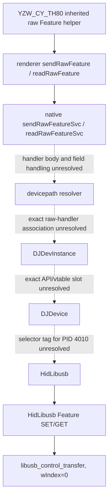

# Phase 4.1 — Native RPC dispatch and device identity resolution

**Analysis date:** 2026-11-01  
**Target:** EPOMAKER Driver 1.0.0 macOS app, `iot_driver` Mach-O x86-64  
**Method:** static inspection of Electron `dist/index.js`, native symbols and disassembly only.

## Evidence labels

- **CONFIRMED** — directly represented by the bundle, symbol table, embedded configuration or disassembly.
- **STRONGLY SUPPORTED** — multiple independent artifacts agree, but one mapping edge remains indirect.
- **HYPOTHESIS** — plausible interpretation, not sufficient to assert reachability.
- **UNKNOWN** — the available static evidence does not establish the claim.

No app execution, HID traffic, physical probing or updater execution was performed.

## 1. RPC contract and service registration

### Renderer client

**CONFIRMED — `dist/index.js`, offsets ~2,335,490–2,339,600:** the renderer constructs `DriverGrpcClient("[::]:3814", credentials.createInsecure())` and registers distinct unary methods:

- `sendMsg`
- `readMsg`
- `sendRawFeature`
- `readRawFeature`

The raw methods are distinct RPC routes, not frontend aliases for `sendMsg` / `readMsg`.

### Protobuf wire schema

**CONFIRMED — `dist/index.js`, offsets ~2,306,439–2,308,017:** generated `SendMsg` protobuf decoding/encoding defines:

| Wire field | Name | Type |
|---:|---|---|
| 1 | `devicepath` | string |
| 2 | `msg` | bytes |
| 3 | `checksumtype` | enum |
| 4 | `dangledevtype` | enum |

`ReadMsg` contains only field 1, `devicepath` (string).

These are protobuf field numbers, **not Rust in-memory byte offsets**. The native in-memory offsets for each Prost message field have not been independently established and are intentionally not guessed.

Enum definitions in the renderer bundle:

```text
CheckSumType: BIT7=0, BIT8=1, NONE=2
DangleDevType: NONE=0, KEYBOARD=1, MOUSE=2
```

### Native Tonic routes

**CONFIRMED:** native symbols include generated Tonic service wrappers for:

- `sendMsgSvc<GrpcServer>` with request `SendMsg` and response `ResSend`;
- `sendRawFeatureSvc<GrpcServer>` with request `SendMsg` and response `ResSend`;
- `readMsgSvc<GrpcServer>` with request `ReadMsg` and response `ResRead`;
- `readRawFeatureSvc<GrpcServer>` with request `ReadMsg` and response `ResRead`.

The generated service wrapper drop-glue symbols are folded by identical-code folding in pairs (raw/ordinary methods share addresses for the generic wrapper shape). That is not proof that their `GrpcServer` method bodies are identical.

**UNKNOWN:** a complete native route-registration → concrete `GrpcServer::send_raw_feature` / `read_raw_feature` body → final device method chain has not been recovered. The binary retains drop-glue/type symbols for the async closures, but their presence alone does not expose the poll-state-machine's concrete trait dispatch.

## 2. Renderer raw helpers and `dangledevtype`

**CONFIRMED — `dist/index.js`, offsets ~2,339,142 onward:** `sendRawFeature` constructs `SendMsg`, sets `devicepath`, `msg`, `checksumtype`, and `dangledevtype`, then calls `client.sendRawFeature`. It resolves `true` when `ResSend.err` is empty and `false` for RPC errors or nonempty error text. `readRawFeature` constructs `ReadMsg`, sets `devicepath`, calls `client.readRawFeature`, and returns response bytes or `undefined` on RPC failure.

**CONFIRMED — shared `USBDevice.writeRawFeatureCmd`, offset ~2,351,176:** the helper derives the request's `dangledevtype` from renderer `devArr` membership:

- `0` — no dongle-common keyboard/mouse association;
- `1` — dangle/dongle keyboard;
- `2` — dangle/dongle mouse.

The protobuf enum names are `NONE`, `KEYBOARD`, and `MOUSE` respectively. `checksumtype` uses the separate enum (`BIT7=0`, `BIT8=1`, `NONE=2`).

**Important distinction:** `dangledevtype` is a per-request enum. `SupportDev.dongle_common` is a per-device support-table property. They are not the same field.

**CONFIRMED:** native transport selection in `DJDevice::new` is performed from the already-built `DJDeviceInfo` record, before an RPC arrives. Therefore `dangledevtype` is not the selector used by `DJDevice::new`.

**UNKNOWN:** whether native raw-RPC handlers use `dangledevtype` to select a high-level API object, alter command framing, or otherwise route the operation. No direct native field-read-to-branch chain has been established. It is also unknown whether `checksumtype` is applied in the raw handler, passed to a device method, or ignored for a subset of operations.

## 3. Native device lookup and async dispatch evidence

### Path resolver

**CONFIRMED — `iot_driver::grpc_server::get_dev_from_path`, `0x1000603a0`:** calls `DJDeviceManger::get_dev_list`, locks the shared device list, iterates `Arc<DJDevInstance>` values, and produces a result used by path-oriented gRPC operations. The input path is passed into the iterator/filter construction. The exact closure predicate and the precise `DJDevInstance` field used for equality are not fully reconstructed from the optimized machine code.

**CONFIRMED — `iot_driver::grpc_server::get_grpc_dev`, `0x1000606c0`:** separately maps the manager's `Arc<DJDevInstance>` list into gRPC `DjDev` values. Direct callers observed at `0x10009bff2` and `0x10009cfef` belong to device-list/event handling, not proof of raw Feature dispatch.

### Async state machines

**CONFIRMED:** generated async service wrapper symbols exist for `sendRawFeatureSvc`, `readRawFeatureSvc`, `sendMsgSvc`, and `readMsgSvc`. The native binary also has async helpers named `GrpcServer::send_msg_by_dev_path` and `GrpcServer::read_msg_by_dev_path` (their future/drop-glue types are present).

**UNKNOWN:** the concrete poll function / closure-to-handler association for the raw methods has not been unambiguously mapped to the relevant `get_dev_from_path` xref or `DJDevInstance` vtable slot. The four direct `get_dev_from_path` call sites found during this pass are in optimized async functions whose surrounding request/response state includes other operations (including OTA and SetLight paths); simply assigning one to raw Feature based on its use of the resolver would be unsound.

### Response and errors

**CONFIRMED:** the protobuf response types are `ResSend` and `ResRead`; renderer code checks `ResSend.err` and extracts `ResRead.msg`. `ResRead` wire fields are `err` (field 1, string) and `msg` (field 2, bytes). The precise native error-conversion branches and all `Status` mappings for raw methods remain **UNKNOWN** until the raw handler body is identified.

## 4. SupportDev records and construction

### Embedded records

**CONFIRMED — embedded TOML in `iot_driver`:** the native `support` array includes:

```toml
{ vid = 0x3151, pid = 0x4011, usage = 2, usage_page = 0xffff, interface_number = 2, dongle_common = true }
{ vid = 0x3151, pid = 0x4010, usage = 2, usage_page = 0xffff, interface_number = 2 }
```

It also includes `4014` and `4017` as `dongle_common=true`; BLE entries `4013` and `4012` have `interface_number=-1, ble=true`. Bootloader records are in the separate `boot` array.

### HID-to-info conversion

**CONFIRMED — `DJDeviceInfo::from_hid_info`, `0x1000c8b00`:** reads the enumerated HID device's VID, PID, usage, usage page, interface number and path through `hidapi::DeviceInfo` accessors. The enumerated interface number is preserved in `DJDeviceInfo` at offset `0x28`.

The function writes a caller-supplied class/type value at offset `0x38` and derives bytes at offsets `0x39` and `0x3a` from its fourth argument. The call site in the HID enumeration path passes a pointer associated with the lazily initialized `SUPPORTDEVLIST` object, not an obvious pointer to the currently matched 16-byte `SupportDev` record. Consequently, the exact source-field-to-`+0x39` / `+0x3a` mapping is **UNKNOWN**. It must not be asserted that `+0x3a` is the `ble` boolean or that it is simply the `SupportDev.interface_number` without further proof.

### Backend selector

**CONFIRMED — `DJDevice::new`, `0x1000c8ea0`:** compares `DJDeviceInfo[0x3a]` with `2`:

```text
if info[0x3a] == 2:
    construct HidLibusb
else:
    construct HidBLE
```

This is construction-time selection.

**UNKNOWN for both physical identities:** although `4010` and `4011` both have `interface_number=2` in the embedded support table, this pass did not prove that those records produce `DJDeviceInfo[0x3a] == 2`. The record-matching loop compares VID, PID, usage and usage page; it does not visibly compare the enumerated interface number in that matching predicate. The missing transformation from the support configuration object into the two selector bytes remains a material edge.

## 5. Receiver high-level class construction

**CONFIRMED — manager refresh state machine, `0x1000c66ad`–`0x1000c66bd`:** after a `DJDevice` has been constructed, the state machine tests:

```text
if DJDeviceInfo[0x3a] != 2:
    take alternate (BLE) branch
else if DJDeviceInfo[0x39] != 2:
    construct YZWDangleCommon
else:
    take normal USB-device branch
```

The `YZWDangleCommon::new` call is at `0x1000c7647`; constructor entry is `0x10005fdd0`. The constructor copies a `0xf8`-byte `DJDevice` value into the wrapper and initializes its mutex state. It is therefore a high-level wrapper around the already-created `DJDevice`, not a separate USB transport implementation.

**STRONGLY SUPPORTED:** the `dongle_common=true` receiver record is intended to participate in this high-level distinction, because the class factory has a dedicated `YZWDangleCommon` branch and the support table marks receiver-class PIDs accordingly.

**UNKNOWN:** the exact dataflow from the matching `3151:4011` SupportDev record's `dongle_common` property to `DJDeviceInfo[0x39]`, and therefore the exact proof that PID `4011` takes the `YZWDangleCommon` branch. The branch predicate itself is confirmed; the per-device tag assignment is not.

## 6. Reachability verdict

The required chain is:



**UNKNOWN — the actual TH80 Pro raw Feature RPC has not been proven to reach `HidLibusb::send_feature` or `HidLibusb::get_feature`.** The frontend capability and generic transport are both confirmed independently; the native service dispatch and per-device selector-value edges are still missing.

## 7. Exact unresolved edges

1. Native raw handler entry and poll function for `sendRawFeatureSvc`.
2. Native raw handler entry and poll function for `readRawFeatureSvc`.
3. Native Prost in-memory field offsets and exact reads of `checksumtype` / `dangledevtype`.
4. Exact `devicepath` predicate and `DJDevInstance` lookup field.
5. Exact `DJDevInstance` API/vtable slot invoked by raw Feature handlers.
6. Exact `SupportDevList` dataflow into `DJDeviceInfo[0x39]` and `[0x3a]`.
7. Exact `4010` and `4011` selector values and resulting backend/class path.
8. Whether `YZWDangleCommon` changes command framing, configuration storage, or only high-level API behavior.
9. Whether a physical TH80 raw Feature operation reaches the generic libusb Feature methods.

## 8. Static references

- Renderer: `dist/index.js`, RPC helper and protobuf code offsets listed above.
- `get_dev_from_path`: `0x1000603a0`.
- `get_grpc_dev`: `0x1000606c0`.
- `DJDeviceInfo::from_hid_info`: `0x1000c8b00`.
- `DJDevice::new`: `0x1000c8ea0`.
- `YZWDangleCommon::new`: `0x10005fdd0`; manager call site `0x1000c7647`.
- `DJDeviceManger::get_dev_list`: native symbol resolved by `llvm-nm -n` / `c++filt`.
- `HidLibusb::new`: `0x100047d30`.
- `HidLibusb::send_feature`: `0x100048290`.
- `HidLibusb::get_feature`: `0x100048460`.
