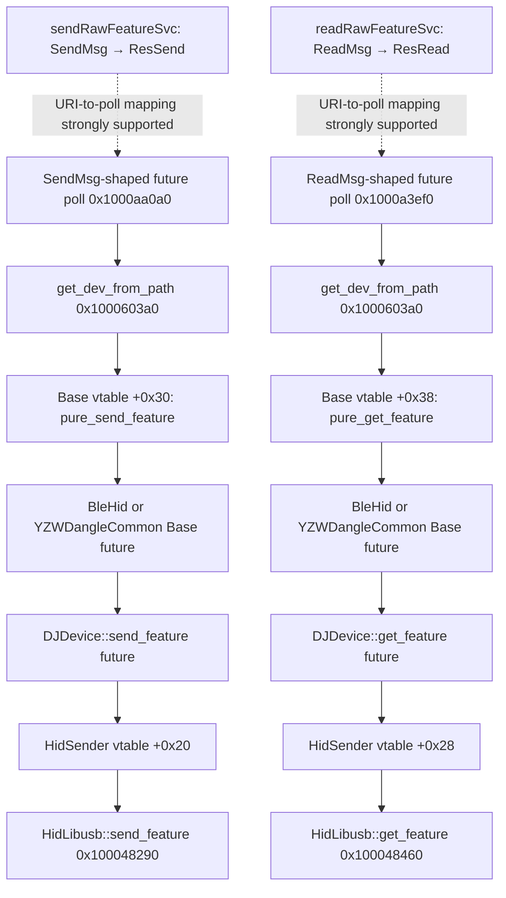

# Phase 4.2 — Async raw Feature RPC dispatch

Date: 2026-11-01  
Binary: macOS x86-64 `iot_driver` from EPOMAKER Driver 1.0.0

## Binary provenance and address validation

Exact analyzed executable:

`../.phase3-work/mac/EPOMAKER Driver 1.0.0/EPOMAKER Driver.app/Contents/Resources/app/iot_driver`

- SHA-256: `22c5dc67ba77e2373a5ffdbb0312ed8c8e73eb16e78037764eb676a030b2724b`
- Size: `6,075,584` bytes
- Format: x86-64 Mach-O, PIE, base used for these VM addresses: `0x100000000`
- Only one `iot_driver` copy was found under `.phase3-work`.
- No IDA/Ghidra database was identified; analysis artifacts are `/tmp/th80_iot.dis` and the focused `.asm` files documented in the Phase 4.2 handoff.

The following VM addresses were re-disassembled from this exact fingerprinted file: `0x1000c8b00`, `0x1000c8ea0`, `0x100048290`, and `0x100048460`. These are virtual addresses, not file offsets.

For the Mach-O `__TEXT` segment (`vmaddr=0x100000000`, `fileoff=0`), the corresponding file offsets are `0xC8B00`, `0xC8EA0`, `0x48290`, and `0x48460`, respectively.

## Scope and safety

Static Mach-O analysis only. No Feature GET/SET requests, Output reports, device probes, firmware updater, bootloader operation, or configuration changes were performed.

## Executive result

The native raw Feature routes are registered as Tonic unary services:

- `sendRawFeatureSvc<GrpcServer>`: `SendMsg → ResSend`
- `readRawFeatureSvc<GrpcServer>`: `ReadMsg → ResRead`

The generated route closure drop glue is folded with the corresponding ordinary `sendMsgSvc` / `readMsgSvc` closure drop glue. This establishes identical drop-glue code, **not** identical handlers or call relationships.

Two optimized generator poll functions have the request shape and behavior expected for the SendMsg and ReadMsg handlers:

- `0x1000aa0a0`: SendMsg-shaped future; reads and normalizes `dangledevtype`; calls `get_dev_from_path` at `0x1000aa1da`.
- `0x1000a3ef0`: ReadMsg-shaped future; calls `get_dev_from_path` at `0x1000a3f5d`.

Their assignment specifically to the raw routes rather than the ordinary routes is **STRONGLY SUPPORTED**, not uniquely proven: the generated route closure/drop-glue types are folded, and the same protobuf request types are shared by the ordinary and raw RPCs.

## Route and request contracts

The renderer protobuf schema establishes:

| Route | Request | Response |
|---|---|---|
| `sendRawFeature` | `SendMsg` | `ResSend` |
| `readRawFeature` | `ReadMsg` | `ResRead` |

`SendMsg` fields: `devicepath`, `msg`, `checksumtype`, `dangledevtype`.  
`ReadMsg` field: `devicepath`.

The native route closure drop-glue symbols are:

- `readMsgSvc` and `readRawFeatureSvc`: shared address `0x100040990`.
- `sendMsgSvc` and `sendRawFeatureSvc`: shared address `0x100040a60`.

The response unary closure drop-glue symbols are at `0x100086110` (ReadMsg/ResRead) and `0x100086230` (SendMsg/ResSend). Shared drop glue is not proof of a shared method body.

## Candidate async handler state machines

### SendMsg-shaped handler — poll at 0x1000aa0a0

The generator state discriminant is read from `future+0x99`. On its initial state it moves the captured SendMsg fields into the future's working area:

- `future+0x40..0x58`: device-path string and byte-vector state.
- `future+0x68`: checksum enum storage.
- `future+0x70`: dangle-device enum storage.
- `future+0x98`: additional captured state byte.

Relevant instructions:

- `0x1000aa113..0x1000aa11f`: copies the final two request qwords, including checksum and dangle type.
- `0x1000aa13a..0x1000aa14b`: reads `future+0x70` and normalizes the enum:
  - input 1 → 1
  - input 2 → 2
  - all other values → 0
- `0x1000aa1da`: calls `iot_driver::grpc_server::get_dev_from_path` at `0x1000603a0`.

The normalized value is saved in a stack local at `rsp+0x5c` and is passed in RCX to Base vtable slot `+0x30` at `0x1000aa799` and `0x1000aa7d7`. That slot is `Base::pure_send_feature`. The Base method constructor captures the byte in its async future (`+0x398` in the future environment). Native consumption and propagation into the Feature future are therefore **CONFIRMED**. The captured value has a concrete effect in the DJDevice SET future: values 0 and 1 select two different checksum insertion layouts; value 2 bypasses checksum insertion. The checksum byte is computed from a prefix of the report and inserted at a selector-dependent offset. This does not change the selected Base method or transport. `checksumtype` remains unproven/unused in this recovered native path.

After lookup, the state machine performs multiple indirect calls through stored vtables, including `call *0x18(vtable)` at `0x1000aa302`, `0x1000aa33b`, `0x1000aa374`, `0x1000aa3a6`, and `0x1000aa3dc`. These are async trait/future dispatch points. The future-poll calls at `+0x18` are polls of the returned async future. The concrete Base trait method factories are separately visible at the terminal dispatch sites described below.

### ReadMsg-shaped handler — poll at 0x1000a3ef0

The generator discriminant is read from `future+0x41`. The initial state extracts the device path and calls `get_dev_from_path` at `0x1000a3f5d`.

The future subsequently polls the returned Base Feature future through its Future vtable (`call *0x18` at `0x1000a4025`, `0x1000a405e`, `0x1000a4097`, `0x1000a40d0`, and `0x1000a4109`). Its terminal dispatch calls Base vtable slot `+0x38` at `0x1000a4525`, `0x1000a4673`, and `0x1000a469f`, which is `Base::pure_get_feature` for both target Base implementations.

## Device-path lookup

`iot_driver::grpc_server::get_dev_from_path` is at `0x1000603a0`.

Confirmed behavior from its disassembly:

1. Retrieves the manager's device list.
2. Locks/iterates the list of `Arc<DJDevInstance>`.
3. Uses the supplied path in the lookup/filter operation.
4. Returns a result containing the matching device instance or a not-found result.

The function builds an iterator over the manager’s `Arc<DJDevInstance>` list and captures the supplied `devicepath` string in the iterator/filter closure environment (`0x10006041d`). The selected `Arc<DJDevInstance>` is retained and returned to the handler. The closure’s final string-comparison predicate and exact `DJDevInstance` field compared with `devicepath` are not yet resolved; do not claim a specific field offset or comparison routine. The handler future retains the matched `Arc<DJDevInstance>` while it invokes the Base method factory. The async future `+0x18` indirect calls are Future::poll dispatches, not additional device-method slots.

## Base trait vtables and concrete async dispatch

The indirect calls are now resolved against the static Base vtables:

| Base implementor | Vtable | `+0x18` get_dev | `+0x30` pure_send_feature | `+0x38` pure_get_feature |
|---|---:|---:|---:|---:|
| `BleHid` | `0x1003d1f10` | `0x100035fa0` | `0x100038e50` | `0x100039020` |
| `YZWDangleCommon` | `0x1003d2160` | `0x10005fe80` | `0x1000610d0` | `0x100061170` |

The raw SendMsg-shaped state machine calls Base slot `+0x30` at `0x1000aa799` and `0x1000aa7d7`. The ReadMsg-shaped state machine calls Base slot `+0x38` at `0x1000a4525`, `0x1000a4673`, and `0x1000a469f`. These are the actual async method-factory calls, distinct from the `Future::poll` calls through the returned future's `+0x18` slot.

The Base futures then delegate to the DJDevice Feature futures:

- `BleHid::pure_send_feature` future poll: `0x1000910c0`.
- `YZWDangleCommon::pure_send_feature` future poll: `0x10008ed20`.
- `Base::pure_get_feature` future poll: `0x100091ef0` (shared optimized poll body).
- DJDevice send Feature future poll: `0x1000959e0`.
- DJDevice get Feature future poll: `0x1000b4060`.

The Base send poll bodies call the DJDevice send Feature future; the Base get poll body calls the DJDevice get Feature future. Those DJDevice futures dispatch through the `HidSender` trait object. For the target devices, the selected HidLibusb vtable maps `+0x20` to send and `+0x28` to get, as described below.

## Downstream Feature transport evidence

The generic device layer contains async `DJDevice::send_feature` and `DJDevice::get_feature` futures. Their poll paths are visible at:

- `0x1000959e0`: Send Feature future.
- `0x1000b4060`: Get Feature future.

The Send Feature future reaches a `HidSender` trait-object dispatch through vtable slot `+0x20`; the Get Feature future uses the corresponding read dispatch. For the libusb implementation, the concrete vtable at `0x1003d28e0` contains:

| Vtable offset | Target | Concrete method |
|---:|---:|---|
| `+0x20` | `0x100048290` | `HidLibusb::send_feature` |
| `+0x28` | `0x100048460` | `HidLibusb::get_feature` |

The backend method implementations and vtable entries are confirmed. The Base vtable slot and Base-to-DJDevice Feature future delegation are confirmed. The only remaining end-to-end uncertainty is whether the raw URI selects these candidate SendMsg/ReadMsg poll functions or whether the ordinary routes share the same poll bodies.

## GET and SET graphs

The candidate handler-to-Base-to-DJDevice-to-HidSender path is confirmed. Only the dashed raw-URI-to-candidate-poll edges remain strongly supported rather than uniquely proven.

## Evidence classification

| Edge / finding | Classification | Evidence |
|---|---|---|
| Raw route → SendMsg/ResSend and ReadMsg/ResRead contracts | CONFIRMED | Generated service symbols and protobuf contract |
| Raw and ordinary route closures share drop-glue addresses | CONFIRMED | `0x100040990`, `0x100040a60` |
| SendMsg-shaped poll reads/normalizes dangledevtype | CONFIRMED | `0x1000aa13a..0x1000aa14b` |
| SendMsg-shaped poll calls manager path lookup | CONFIRMED | `0x1000aa1da` |
| ReadMsg-shaped poll calls manager path lookup | CONFIRMED | `0x1000a3f5d` |
| These two poll functions are uniquely the raw routes | STRONGLY SUPPORTED | Request shape and route closure types; ordinary methods share request types and folded glue |
| SendMsg-shaped poll → Base::pure_send_feature slot +0x30 | CONFIRMED | `0x1000aa799`, `0x1000aa7d7`; Base vtables at `0x1003d1f10` and `0x1003d2160` |
| ReadMsg-shaped poll → Base::pure_get_feature slot +0x38 | CONFIRMED | `0x1000a4525`, `0x1000a4673`, `0x1000a469f`; Base vtables at `0x1003d1f10` and `0x1003d2160` |
| Base Feature futures → DJDevice send/get Feature futures | CONFIRMED | Base poll functions `0x1000910c0`, `0x10008ed20`, `0x100091ef0`; nested DJDevice polls `0x1000959e0`, `0x1000b4060` |
| DJDevice send/get futures dispatch to HidSender methods | CONFIRMED | Future poll bodies and HidSender vtable dispatch |
| HidLibusb vtable +0x20/+0x28 target send/get Feature | CONFIRMED | Static vtable at `0x1003d28e0` |
| Candidate SendMsg/ReadMsg handler → Base Feature methods → DJDevice Feature futures | CONFIRMED | State-machine calls to Base slots and Base future poll bodies |
| Raw route URI specifically selects these candidate handler futures | STRONGLY SUPPORTED | Raw and ordinary routes share request types and folded closure drop glue |
| Candidate SendMsg/ReadMsg poll → Base Feature method → DJDevice Feature future → HidLibusb | CONFIRMED | Base slots, Base future polls, DJDevice future polls and HidLibusb vtable are all resolved |
| Raw route URI → candidate SendMsg/ReadMsg poll → HidLibusb | STRONGLY SUPPORTED | Only raw-vs-ordinary URI-to-poll assignment remains open |

## Remaining work

- Decode the service router's exact function-pointer mapping from each URI to the concrete handler.
- Establish the exact response/error conversion path for `ResSend` and `ResRead`.
- Determine whether the protobuf `checksumtype` is consumed elsewhere; the `dangledevtype` checksum-layout effect is now established in the DJDevice SET future (see below).
- Determine whether ordinary `sendMsg`/`readMsg` and raw Feature routes are true aliases or merely share request/closure shapes.

## Native dangledevtype effect in DJDevice SET

The Base `pure_send_feature` factories store the byte argument from CL at future-environment offset `+0x398` (`0x100038e78` for BleHid; corresponding YZWDangleCommon factory at `0x1000610d0`). The Base send future poll copies that captured byte into the nested DJDevice send future (`0x100091101..0x100091124`; the YZWDangleCommon path copies the same byte at `0x10008ed5a..0x10008ed74`). The DJDevice SET future poll at `0x1000959e0` reads the propagated selector at `0x100095be2` (saved disassembly `/tmp/th80-djdevice-send-feature-poll-recheck.asm`).

Observed branch behavior, interpreted with the SendMsg-shaped handler's normalization (1→1, 2→2, other→0):

| Normalized dangledevtype | DJDevice SET behavior |
|---:|---|
| `0` | Generates a complemented additive checksum over seven report bytes; insertion position depends on `DJDeviceInfo+0x3A`. For selector 2, checksum is written at report offset 7; for other selector values, offset 8. |
| `1` | Generates a complemented additive checksum over eight report bytes; insertion position depends on `DJDeviceInfo+0x3A`. For selector 2, checksum is written at report offset 8; for other selector values, offset 9. |
| `2` | Skips the checksum-generation branch and proceeds to the HidSender SET dispatch. |

For both target PIDs, metadata `+0x3A` is 2, so the selector-2 insertion positions apply. The arithmetic is byte addition followed by bitwise NOT (`notb`), with report data beginning at byte 1. Bounds checks precede checksum insertion. The native effect is therefore **checksum layout/serialization**, not device selection, Base method selection, or transport selection.

The renderer's enum labels (`NONE=0`, `KEYBOARD=1`, `MOUSE=2`) describe the caller's semantic choice; native code uses the numeric value as the above layout selector. Do not conflate it with `SupportDev.dongle_common` or `DJDeviceInfo+0x39/+0x3A`.

`checksumtype` remains **UNKNOWN**: the request schema carries it, but this recovered Base/DJDevice Feature method chain does not establish a corresponding native consumer.

## Router mapping limitation

`DriverGrpcServer<GrpcServer>::call` is at `0x100048d50`. It performs the HTTP/2 gRPC path routing and selects service objects from static route data (including objects in the `0x1003cd8a8..0x1003cd968` region). The generated route closure drop-glue symbols identify raw and ordinary services, but the raw and ordinary `send` routes share the folded drop-glue address `0x100040a60`, and the corresponding `read` routes share `0x100040990`. The route dispatch code does not provide a separately named handler symbol for each raw URI. The service route data and poll-body shape support the SendMsg/ReadMsg candidate mapping, but no unique static pointer edge from the raw URI's service object to `0x1000aa0a0` / `0x1000a3ef0` has been recovered. Consequently, raw URI → candidate poll remains STRONGLY SUPPORTED, not CONFIRMED. The candidate poll → Base method → DJDevice Feature future → HidSender transport path itself is independently confirmed.

No claim is made that shared drop glue proves shared service handler logic. Conversely, the inability to distinguish optimized/folded generated closure bodies is not evidence that raw and ordinary routes differ.
