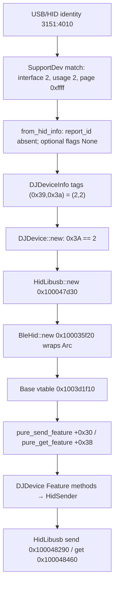
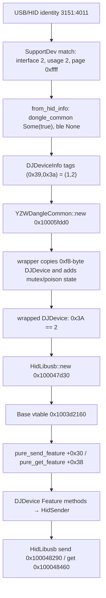
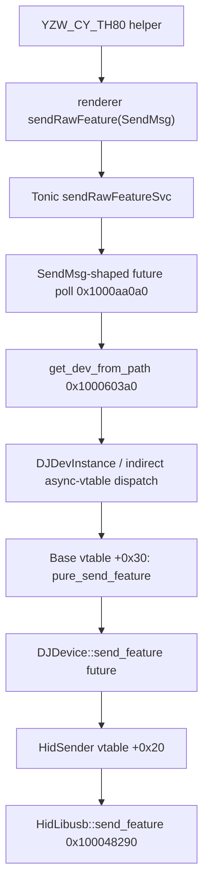
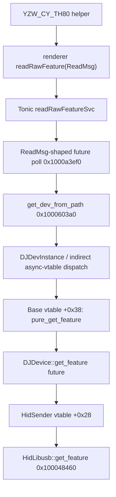

# Phase 4.2 — End-to-end raw Feature reachability

Date: 2026-11-01  
Binary: macOS x86-64 `iot_driver` from EPOMAKER Driver 1.0.0

## Binary provenance and address validation

Exact analyzed executable:

`../.phase3-work/mac/EPOMAKER Driver 1.0.0/EPOMAKER Driver.app/Contents/Resources/app/iot_driver`

- SHA-256: `22c5dc67ba77e2373a5ffdbb0312ed8c8e73eb16e78037764eb676a030b2724b`
- Size: `6,075,584` bytes
- Format: x86-64 Mach-O, PIE, base used for these VM addresses: `0x100000000`
- Only one `iot_driver` copy was found under `.phase3-work`.
- No IDA/Ghidra database was identified; analysis artifacts are `/tmp/th80_iot.dis` and the focused `.asm` files documented in the Phase 4.2 handoff.

The following VM addresses were re-disassembled from this exact fingerprinted file: `0x1000c8b00`, `0x1000c8ea0`, `0x100048290`, and `0x100048460`. These are virtual addresses, not file offsets.

For the Mach-O `__TEXT` segment (`vmaddr=0x100000000`, `fileoff=0`), the corresponding file offsets are `0xC8B00`, `0xC8EA0`, `0x48290`, and `0x48460`, respectively.

## Executive findings

The support metadata and manager branches establish these backend objects:

- **3151:4010 TH80 Pro:** `DJDeviceInfo(+0x39,+0x3A)=(2,2)` → `BleHid` Base wrapper around `DJDevice` → `HidLibusb`. `BleHid` is a higher-level API wrapper; it is not the `HidBLE` transport.
- **3151:4011 receiver:** `DJDeviceInfo(+0x39,+0x3A)=(1,2)` → `YZWDangleCommon` wrapper around `DJDevice` → `HidLibusb`.

The candidate SendMsg/ReadMsg handler futures call `Base::pure_send_feature` / `Base::pure_get_feature` through resolved vtable slots, and the Base futures delegate to DJDevice Feature futures and the HidSender vtable. The remaining uncertainty is only whether the raw URI maps to these candidate poll bodies or shares them with the ordinary SendMsg/ReadMsg routes. Thus the complete candidate dispatch chain is CONFIRMED; raw-URI-specific reachability is STRONGLY SUPPORTED.

## Per-device construction

### 3151:4010 — TH80 Pro

### 3151:4011 — receiver

## Transport methods

`DJDevice::new` at `0x1000c8ea0` selects `HidLibusb` exactly when `DJDeviceInfo+0x3A == 2`; otherwise it selects `HidBLE`. The manager then wraps the normal `(2,2)` DJDevice in `BleHid` at `0x1000c758e`, or the `(1,2)` device in `YZWDangleCommon` at `0x1000c7647`. These are Base/API wrappers; the concrete HID transport remains HidLibusb for both target PIDs.

The `HidLibusb` trait-object vtable is at `0x1003d28e0`:

| Vtable offset | Function pointer | Meaning |
|---:|---:|---|
| `+0x20` | `0x100048290` | `HidLibusb::send_feature` |
| `+0x28` | `0x100048460` | `HidLibusb::get_feature` |

The generic DJDevice Feature futures use a HidSender trait-object call at the corresponding backend dispatch point. Thus the same concrete backend type supplies both SET and GET, through different methods.

The previously recovered libusb request details remain applicable:

- SET: bmRequestType `0x21`, bRequest `0x09`, wValue `0x0300`, wIndex `0`, wLength `64`, timeout 2000 ms; rejects shorter buffers and sends 64 bytes.
- GET: bmRequestType `0xa1`, bRequest `0x01`, wValue `0x0300`, wIndex `0`, wLength `64`, timeout 2000 ms.

No interface claim or alternate-setting selection was found. Interface 2 is used in SupportDev matching and stored in metadata; the libusb control-transfer wIndex remains hardcoded to zero.

## Raw RPC path

### SET

### GET

The route wrapper drop glue is shared with the ordinary `sendMsgSvc`/`readMsgSvc` closures. The SendMsg-shaped future reads `dangledevtype`; the ReadMsg-shaped future contains only the device-path lookup. These are strong structural links to the raw routes, but the ordinary routes share the same protobuf request types, so the route-to-poll assignment is not uniquely proven from drop glue.

## dangledevtype and checksumtype

Native SendMsg-shaped poll code reads `dangledevtype` at `0x1000aa13a` and normalizes 1→1, 2→2, all other values→0. The normalized value is stored in a stack local, passed in RCX to Base vtable slot `+0x30` (`pure_send_feature`) at `0x1000aa799` and `0x1000aa7d7`, and captured at Base future offset `+0x398` (`0x100038e78`; corresponding YZWDangleCommon factory `0x1000610d0`). Base send poll copies it into the nested DJDevice SET future (`0x100091101..0x100091124` and `0x10008ed5a..0x10008ed74`).

The DJDevice SET future at `0x1000959e0` consumes this byte at `0x100095be2` and uses it as a checksum-layout selector:

| dangledevtype | Native behavior | With target metadata `+0x3A=2` |
|---:|---|---|
| `0` | Complemented additive checksum over 7 report bytes | inserted at report offset 7 |
| `1` | Complemented additive checksum over 8 report bytes | inserted at report offset 8 |
| `2` | Skip checksum-generation branch | no checksum insertion |

The checksum is the byte-wise sum of the selected report prefix followed by bitwise NOT (`notb`). For non-2 metadata selector values, insertion is at report offset 8 for dangledevtype 0 and offset 9 for dangledevtype 1. The native effect is checksum generation/insertion and serialization layout; it does not select a different device, Base method, or transport. The request's `checksumtype` field remains UNKNOWN in this path; do not infer its behavior from the frontend enum labels.

## Explicit answers

1. **Does the TH80 raw Feature RPC reach HidLibusb?**  
   Strongly supported. Its support record yields tags (2,2), and the manager constructs plain DJDevice with HidLibusb. The candidate SendMsg/ReadMsg state machines dispatch through Base trait slots `+0x30` (SET) and `+0x38` (GET); the remaining route-specific uncertainty is whether the raw URI selects these candidate poll functions rather than the ordinary URI.

2. **Does the receiver raw Feature RPC reach HidLibusb?**  
   Strongly supported. Its `dongle_common=true` record yields tags (1,2), selecting YZWDangleCommon around DJDevice; DJDevice selects HidLibusb because +0x3A is 2. The receiver Base vtable is the YZWDangleCommon vtable at `0x1003d2160`; its `+0x30` and `+0x38` entries dispatch to the wrapper Feature methods. The remaining uncertainty is URI-to-poll assignment, not wrapper/backend dispatch.

3. **Do both operations use the same transport methods?**  
   They use the same `HidLibusb` backend implementation, but different concrete methods: SET calls `send_feature` at `0x100048290`; GET calls `get_feature` at `0x100048460`.

4. **Does dangledevtype change the path?**  
   Native code reads and normalizes it and passes the normalized value to `Base::pure_send_feature`. The nested DJDevice SET future uses it to choose checksum generation and insertion layout (0→7-byte sum, 1→8-byte sum, 2→skip). It does not select a different Base method slot or transport.

5. **Is YZWDangleCommon a wrapper over DJDevice?**  
   Yes. Its constructor copies a 0xf8-byte DJDevice and initializes synchronization/poison state. Its Base Feature futures delegate to the wrapped DJDevice Feature methods.

6. **Are generic Feature methods reachable?**  
   The candidate handler futures call Base slots `+0x30`/`+0x38`; those Base implementations delegate to DJDevice send/get Feature futures, which dispatch through the HidSender vtable to HidLibusb. The candidate native call chain is confirmed. Raw-route-specific reachability remains strongly supported pending the URI-to-poll mapping.

## Evidence classification

| Edge | Classification |
|---|---|
| VID/PID/usage/interface → SupportDev match | CONFIRMED |
| matched SupportDev copy → from_hid_info fourth argument | CONFIRMED |
| from_hid_info → metadata bytes | CONFIRMED, subject to deserializer default representation noted in metadata report |
| metadata → manager branch | CONFIRMED |
| manager branch → YZWDangleCommon or plain DJDevice | CONFIRMED |
| DJDevice +0x3A==2 → HidLibusb | CONFIRMED |
| HidLibusb vtable +0x20/+0x28 → SET/GET implementations | CONFIRMED |
| raw SET future → get_dev_from_path | CONFIRMED for SendMsg-shaped candidate; raw-route assignment STRONGLY SUPPORTED |
| raw GET future → get_dev_from_path | CONFIRMED for ReadMsg-shaped candidate; raw-route assignment STRONGLY SUPPORTED |
| candidate handler → Base::pure_send_feature / pure_get_feature | CONFIRMED |
| Base Feature futures → DJDevice Feature futures | CONFIRMED |
| exact raw SET/GET route → HidLibusb concrete call | STRONGLY SUPPORTED |
| dangledevtype → checksum generation/insertion layout in SET future | CONFIRMED |

## Remaining unknowns

- Exact Tonic router function-pointer mapping to the SendMsg/ReadMsg poll functions.
- Exact Tonic router URI-to-poll-function mapping distinguishing raw Feature routes from ordinary SendMsg/ReadMsg routes.
- Full response/error conversion to `ResSend` and `ResRead`.
- Whether `checksumtype` has a native consumer in a separate path.
- Native consumption/effect of `checksumtype`.
- Whether ordinary sendMsg/readMsg share the same implementation bodies or merely share request/closure layout.
- Whole-binary audit of every possible metadata constructor/copy/write.
