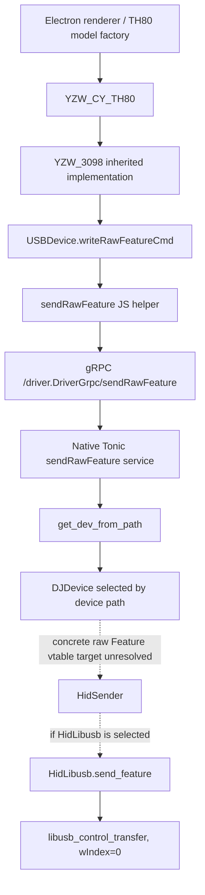
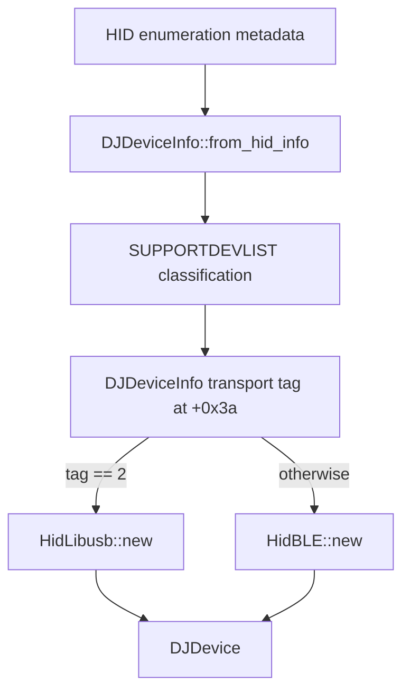

# Phase 4 — macOS native driver call-chain recovery

## Scope and evidence labels

Static analysis only. The Electron bundle and the Mach-O executable were inspected; neither the app nor the Windows updater was executed. No HID request was sent and no hardware was probed.

- **CONFIRMED** — directly visible in source/bundle data or disassembly.
- **STRONGLY SUPPORTED** — multiple static facts agree, but one dispatch edge is not fully proven.
- **HYPOTHESIS** — plausible interpretation requiring further evidence.
- **UNKNOWN** — the available artifacts do not establish the claim.

Native addresses below are Mach-O virtual addresses (`0x100...`). The extracted native executable is `EPOMAKER Driver.app/Contents/Resources/app/iot_driver` (x86-64). Renderer references are byte offsets in `dist/index.js`, not source line numbers; the bundle is minified.

## Executive result

**UNKNOWN / unresolved:** the available static evidence does not yet prove that a real TH80 Pro (`3151:4010`) `sendRawFeature` or `readRawFeature` RPC reaches `HidLibusb::send_feature` / `HidLibusb::get_feature`.

Two important halves are now confirmed independently:

1. **Frontend:** the `YZW_CY_TH80` model is constructed by the model factory and inherits `YZW_3098`; the shared `USBDevice` class implements raw Feature helpers that call the `sendRawFeature` and `readRawFeature` gRPC client methods.
2. **Native:** the gRPC service exposes distinct `sendRawFeature` and `readRawFeature` routes; native device construction chooses `HidLibusb` when the `DJDeviceInfo` transport tag at offset `0x3a` equals `2`; the generic libusb Feature SET/GET functions hardcode interface index zero.

The missing proof is the complete native raw-RPC handler → selected `DJDevice` object → selected sender trait method → concrete libusb Feature method edge, tied to the `3151:4010` device record. The existence of both halves in the same executable is not proof of reachability.

## A. Electron renderer and RPC surface

### RPC registration and client

**CONFIRMED — `dist/index.js`, offsets ~2,335,490–2,339,600:** the generated gRPC service descriptor registers four separate unary methods:

- `/driver.DriverGrpc/sendMsg`
- `/driver.DriverGrpc/readMsg`
- `/driver.DriverGrpc/sendRawFeature`
- `/driver.DriverGrpc/readRawFeature`

The client is created with `new DriverGrpcClient("[::]:3814", credentials.createInsecure())` (offset ~2,337,716). This is a gRPC boundary, not merely Electron IPC.

`SendMsg` carries `devicepath`, `msg`, `checksumtype`, and `dangledevtype`; `ReadMsg` carries `devicepath`. The raw methods use these same protobuf request types but are distinct RPC methods.

### Frontend raw helper implementations

**CONFIRMED — offsets ~2,339,040–2,339,600:**

- `sendRawFeature(devicepath, msg, checksumtype, dangledevtype)` constructs `SendMsg`, sets all four fields, invokes `client.sendRawFeature`, and resolves based on the response `err` field (empty means success). RPC errors resolve `false`.
- `readRawFeature(devicepath)` constructs `ReadMsg`, sets `devicepath`, invokes `client.readRawFeature`, and returns the response `msg` as a `Buffer`; RPC errors return `undefined`.
- The ordinary `sendMsg` / `readMsg` helpers are separately implemented and invoke their correspondingly named RPCs.

### TH80 model relation

**CONFIRMED — offsets ~2,892,952 and ~2,938,155:** `YZW_CY_TH80` is declared as a subclass of `YZW_3098`, and the model factory maps `"yzw_cy_th80"` to `new YZW_CY_TH80(...)`.

**CONFIRMED — offsets ~2,350,000–2,351,750:** the shared `USBDevice` implementation has `writeRawFeatureCmd` and `readRawFeatureCmd`; the write helper eventually invokes the renderer's `sendRawFeature`, and the read helper invokes `readRawFeature`.

**Important qualification:** this proves that the TH80 model inherits raw Feature-capable helpers. It does not, by itself, prove that a particular user-facing TH80 configuration operation calls those helpers. Nor does it prove which native backend receives the resulting RPC.

The frontend's model metadata is not the physical USB descriptor. In `supportYZWDev` (offset ~1,530), the TH80 profile is logical model ID `369`, with `vid=1121`, `pid=16386`, usage 6/page 1. Those decimal values are `0x0461:0x4002`, not physical `0x3151:0x4010`. Do not use this frontend model record as proof of the native HID descriptor or interface mapping.

### `dangledevtype`

**CONFIRMED — offsets ~2,351,176 and ~2,351,602:** `writeRawFeatureCmd` derives a `dangledevtype` value by checking the shared `devArr` for `danglecommondev` mouse/keyboard IDs, selecting `2` for the mouse, `1` for the keyboard, and `0` otherwise. The request passes this value to `sendRawFeature`.

This is a frontend classification hint. Whether and how the native raw handler uses it has not yet been established.

## B. Native gRPC and device lookup

**CONFIRMED:** native symbols include the Tonic service implementation `DriverGrpcServer<GrpcServer>` and generated route service closures for `sendMsgSvc`, `readMsgSvc`, `sendRawFeatureSvc`, and `readRawFeatureSvc`. The corresponding service registration is present in the Mach-O. The native gRPC server constructor is at `0x10005fe90`.

**CONFIRMED:** native helper `iot_driver::grpc_server::get_dev_from_path` is at `0x1000603a0`; it obtains the manager's device list through `DJDeviceManger::get_dev_list` and searches the list using the supplied path. `get_grpc_dev` is at `0x1000606c0` and also consults that device list.

**UNKNOWN:** the complete body-level dispatch from the `sendRawFeatureSvc` / `readRawFeatureSvc` service closures into the raw Feature method on the selected `DJDevice` has not been recovered to the concrete `HidSender` vtable entry. Several generated async state-machine poll functions call `get_dev_from_path`, but the relevant closure-to-poll-to-vtable mapping has not yet been resolved with sufficient certainty to identify the raw method's final implementation.

## C. Native device construction and transport selection

### HID metadata preservation

**CONFIRMED — `DJDeviceInfo::from_hid_info`, `0x1000c8b00`:** the function calls `hidapi::DeviceInfo` accessors for:

- vendor ID;
- product ID;
- usage;
- usage page;
- interface number;
- device path.

It stores these values in the native `DJDeviceInfo` record. The interface number is read from the HID metadata and stored at record offset `0x28`; it is not discarded in this conversion.

The same function also consults native `SUPPORTDEVLIST`. It reads classification fields from the matching support record and stores transport/classification flags at offsets `0x39` and `0x3a`. The embedded native `SupportDev` table includes `3151:4010` (usage 2, page `0xffff`, interface 2) and `3151:4011` (same fields plus `dongle_common=true`). Separate `3151:4012` and `3151:4013` records are marked `ble=true`. The exact transformation from all support-record fields to `DJDeviceInfo` transport byte `+0x3a` is not fully decoded yet.

### `DJDevice::new`

**CONFIRMED — `iot_driver::dj_hid_device::DJDevice::new`, `0x1000c8ea0`:**

```text
if DJDeviceInfo[0x3a] == 2:
    HidLibusb::new(device_info)
else:
    HidBLE::new(device_info)
```

The disassembly compares byte `[rsi + 0x3a]` with `2` at `0x1000c8eba`; the true branch calls `HidLibusb::new` at `0x1000c8ece`, and the other branch calls `HidBLE::new` at `0x1000c96b` (branch target path; constructor call is at `0x1000c8f6b`).

This is a construction-time transport selection based on the native `DJDeviceInfo` tag, not a request-time interpretation of the `dangledevtype` protobuf field.

### `HidLibusb::new`

**CONFIRMED — `HidLibusb::new`, `0x100047d30`:** enumerates libusb devices, compares descriptor VID/PID against the values in `DJDeviceInfo`, opens the matching device, and copies the device metadata into the backend object. The interface number is copied from `DJDeviceInfo` offset `0x28` into the backend's metadata (visible at `0x100047f98` onward).

**UNKNOWN:** the exact interface-claim operation and its use of the copied interface number have not yet been located. The presence of the interface number in the metadata does not establish that the control-transfer `wIndex` is derived from it.

## D. Generic libusb Feature transport

### Feature SET

**CONFIRMED — `HidLibusb::send_feature`, `0x100048290`:** calls `_libusb_control_transfer` at `0x10004831b` with these constant arguments:

| Field | Value |
|---|---:|
| `bmRequestType` | `0x21` |
| `bRequest` | `0x09` |
| `wValue` | `0x0300` |
| `wIndex` | `0x0000` |
| `wLength` | `0x0040` (64) |
| timeout | `0x07d0` (2000 ms) |

The control transfer buffer is the caller-provided report buffer. The method rejects lengths below 64 bytes and uses the first 64 bytes.

### Feature GET

**CONFIRMED — `HidLibusb::get_feature`, `0x100048460`:** calls `_libusb_control_transfer` at `0x10004851b` with:

| Field | Value |
|---|---:|
| `bmRequestType` | `0xa1` |
| `bRequest` | `0x01` |
| `wValue` | `0x0300` |
| `wIndex` | `0x0000` |
| `wLength` | `0x0040` (64) |
| timeout | `0x07d0` (2000 ms) |

The read buffer is initialized to 64 bytes. The transfer result is converted into a byte buffer or a rusb error.

### The interface discrepancy

**CONFIRMED:** the generic libusb Feature SET and GET methods use `wIndex=0`, while the TH80 Pro support/physical descriptor record is interface 2.

**UNKNOWN:** whether the real TH80 Pro raw RPC dispatch invokes either method. The interface number is preserved in `DJDeviceInfo` and copied by `HidLibusb::new`, but these Feature control transfers do not use that field: their `wIndex` is hardcoded zero. This is a real mismatch in the generic implementation, not an alternate encoding of interface 2.

## E. Call graphs

### Frontend path (raw helper capability confirmed)



Dashed edges are intentionally unresolved; this graph must not be read as a proven complete path.

### Native construction path (transport branch confirmed)



## F. Exact answer to the Phase 4 question

> Does a real TH80 Pro (`3151:4010`) RPC operation eventually invoke the generic libusb Feature Report implementation with `wIndex=0`?

**UNKNOWN — not proven by the recovered call graph.**

The frontend TH80 profile inherits methods capable of invoking raw Feature RPCs. The native service exposes the matching RPC endpoints. Native device construction can select `HidLibusb`, and that generic backend's Feature GET/SET methods definitely use `wIndex=0`. However, the final service-handler-to-`HidSender` dispatch has not been tied to the TH80 Pro device object and those specific methods. No claim that the physical TH80 Pro operation reaches `wIndex=0` is justified yet.

## G. Remaining work

1. Resolve each `sendRawFeatureSvc` and `readRawFeatureSvc` generated async closure to its native `GrpcServer` handler and concrete `DJDevice` method.
2. Recover the `DJDevice` sender vtable layout and identify the raw Feature method slot selected by those handlers.
3. Tie the `3151:4010` support-list record to the `DJDeviceInfo` transport tag and its `DJDevice::new` instance; independently do the same for `3151:4011`.
4. Locate the libusb interface claim and determine whether the copied interface number is used there.
5. Recover IOKit Output/Input paths and distinguish them from Feature GET/SET.
6. Continue the Windows updater caller/caller's-caller and buffer provenance analysis. The current evidence still does not connect the `0x14022b510` caller to the named firmware-upgrade operation.

---

# Phase 4.1 addendum — 2026-11-01

This addendum preserves the Phase 4 findings while tightening the distinction between the embedded `SupportDev` record, `DJDeviceInfo` selector bytes, and the generic transport.

## New confirmed findings

1. The native `SendMsg` protobuf wire schema is field 1 `devicepath` (string), field 2 `msg` (bytes), field 3 `checksumtype` (enum), field 4 `dangledevtype` (enum). `ReadMsg` contains field 1 `devicepath`. These are wire field numbers, not native memory offsets.
2. The renderer enums define `CheckSumType` as `BIT7=0`, `BIT8=1`, `NONE=2`; `DangleDevType` as `NONE=0`, `KEYBOARD=1`, `MOUSE=2`.
3. The `dangledevtype` value is derived by the frontend from its dongle-common keyboard/mouse association and is passed per request. It is distinct from `SupportDev.dongle_common`.
4. `DJDeviceInfo::from_hid_info` preserves the enumerated interface number at offset `0x28`.
5. The device-manager state machine at `0x1000c66ad`–`0x1000c66bd` uses `DJDeviceInfo[0x3a]` and `[0x39]`: it takes the alternate BLE branch if `+0x3a != 2`; if `+0x3a == 2` but `+0x39 != 2`, it constructs `YZWDangleCommon` at call site `0x1000c7647`; otherwise it takes the normal USB-device branch.
6. `YZWDangleCommon::new` at `0x10005fdd0` wraps/copies a `0xf8`-byte `DJDevice` object. It is a higher-level API wrapper, not a distinct USB transport.
7. `HidLibusb::new` creates an empty `rusb::ClaimedInterfaces` collection. The `ClaimedInterfaces::new` function at `0x1001b1440` only zero-initializes its collection fields.
8. The native symbol table contains `_libusb_open`, `_libusb_release_interface`, and `_libusb_control_transfer`, but no `_libusb_claim_interface` or `_libusb_set_interface_alt_setting`. Thus the inspected `HidLibusb` path does not claim interface 2 or set an alternate setting.
9. Feature SET and GET still use hardcoded `wIndex=0`; this value is not loaded from the preserved interface metadata.

## Correction / qualification to the earlier selector interpretation

The exact dataflow from the matched `SupportDev` record into `DJDeviceInfo[0x39]` and `[0x3a]` has **not** been established. The call to `DJDeviceInfo::from_hid_info` receives a pointer associated with the lazily initialized `SUPPORTDEVLIST` object; the disassembly does not yet prove that this fourth argument is the currently matched 16-byte `SupportDev` record. Therefore, do not claim that the transport tag is simply the support record's interface number, or that it is the `ble` boolean.

The generic selector rule remains confirmed (`+0x3a == 2` → `HidLibusb`; otherwise `HidBLE`), but the exact selector values for physical `3151:4010` and `3151:4011` remain **UNKNOWN** until the missing support-config-to-info dataflow is resolved.

## Updated central verdict

**UNKNOWN:** the actual TH80 Pro raw Feature RPC has not been proven to reach `HidLibusb::send_feature` or `HidLibusb::get_feature`. The native raw route wrappers, protobuf request schemas, path resolver and generic libusb Feature implementations are confirmed independently, but the raw handler's concrete `DJDevInstance`/`DJDevice`/`HidSender` dispatch remains unresolved.

See [PHASE4_1_NATIVE_DISPATCH.md](PHASE4_1_NATIVE_DISPATCH.md) and [PHASE4_1_INTERFACE_RESOLUTION.md](PHASE4_1_INTERFACE_RESOLUTION.md) for the detailed evidence and call graphs.

---

# Phase 4.2 addendum — 2026-11-01

This addendum supersedes the Phase 4.1 uncertainty about the fourth `from_hid_info` argument and target-device metadata. It does not rewrite or remove the earlier Phase 4/4.1 reports; their dated corrections remain part of the historical record.

## Confirmed SupportDev pointer provenance

`HidSender::get_support_dev` at `0x100036f60` iterates 16-byte records in `SUPPORTDEVLIST`, compares interface number, VID, PID, usage and usage page, copies both qwords of the matching record to a local 16-byte stack object, and passes that local object's address as RCX to `DJDeviceInfo::from_hid_info` at `0x1000c8b00`.

The relevant record offsets are:

| Offset | Field |
|---:|---|
| `+0x00` | interface_number |
| `+0x04` | vid |
| `+0x06` | pid |
| `+0x08` | usage |
| `+0x0A` | usage_page |
| `+0x0C` | report_id |
| `+0x0E` | dongle_common |
| `+0x0F` | ble |

Three call sites in the matching routine pass class/type values 1, 0 and 2 at `0x1000371e6`, `0x100037421`, and `0x1000375ac`. All pass the matched-record copy.

## Metadata correction

`DJDeviceInfo::from_hid_info` writes the actual HIDAPI `DeviceInfo::interface_number()` result to `+0x28`; the support-record interface number is a matching predicate, not the value source for this field.

The fourth argument is read at offsets `+0x0C`, `+0x0E`, and `+0x0F`:

```text
if support.report_id == 2:
    info[0x39] = 2
    info[0x3A] = 2
else:
    info[0x39] = support.dongle_common
    info[0x3A] = support.ble
```

The optional flag representation is consistent with `Option<bool>`: None=2, Some(true)=1, Some(false)=0. The SupportDev sequence visitor includes `Option<bool>` and the config omits the optional flags for the target records.

Target records:

| PID | interface | usage/page | report_id | dongle_common | ble | info +0x39 | info +0x3A |
|---|---:|---|---|---|---|---:|---:|
| 4010 | 2 | 2 / 0xffff | absent/default 0 | None | None | 2 | 2 |
| 4011 | 2 | 2 / 0xffff | absent/default 0 | Some(true) | None | 1 | 2 |

## Per-device manager/backend result

The manager checks `+0x3A` and `+0x39`:

- 4010 `(2,2)`: normal `DJDevice` branch.
- 4011 `(1,2)`: `YZWDangleCommon::new` branch.

`DJDevice::new` at `0x1000c8ea0` chooses `HidLibusb::new` when `+0x3A == 2`, otherwise `HidBLE::new`. Therefore both target devices select the libusb backend; the receiver adds the `YZWDangleCommon` wrapper.

`YZWDangleCommon::new` at `0x10005fdd0` copies/wraps a `0xf8`-byte `DJDevice` and adds synchronization/poison state. It is not a separate transport. The `dongle_common` association is indirect through `DJDeviceInfo+0x39` and the manager branch.

## Raw Feature async-dispatch findings

The raw service routes are Tonic unary services using `SendMsg → ResSend` and `ReadMsg → ResRead`. Their generated closure drop glue is folded with the ordinary `sendMsgSvc`/`readMsgSvc` drop glue, so that equality is not used as call-relationship proof.

Candidate optimized future poll functions:

- SendMsg-shaped: `0x1000aa0a0`. Reads `dangledevtype`, maps 1→1, 2→2, other→0, then calls `get_dev_from_path` at `0x1000603a0`.
- ReadMsg-shaped: `0x1000a3ef0`. Extracts `devicepath` and calls `get_dev_from_path` at `0x1000603a0`.

These request-shape/poll assignments are strongly supported, but exact URI-to-poll mapping remains open because raw and ordinary routes share the protobuf request types and generated service closure shapes.

The generic DJDevice Feature futures are present at poll functions `0x1000959e0` (send) and `0x1000b4060` (get). They dispatch through the `HidSender` trait object. The libusb vtable at `0x1003d28e0` maps `+0x20` to `HidLibusb::send_feature` (`0x100048290`) and `+0x28` to `HidLibusb::get_feature` (`0x100048460`).

The route-future-to-exact-DJDevice-future indirect edge is strongly supported, not fully proven. The final raw RPC reachability claim therefore remains **STRONGLY SUPPORTED**, not CONFIRMED.

## Current central verdict

- 3151:4010 backend construction: **CONFIRMED HidLibusb**.
- 3151:4011 backend construction: **CONFIRMED YZWDangleCommon-wrapped DJDevice using HidLibusb**.
- Raw SET/GET handler path lookup: **CONFIRMED for the SendMsg-/ReadMsg-shaped candidate futures; raw-route assignment STRONGLY SUPPORTED**.
- Raw SET/GET reaching the target devices' concrete HidLibusb methods: **STRONGLY SUPPORTED**, pending exact route/vtable receiver resolution.
- Native `dangledevtype` read/normalization: **CONFIRMED**; its downstream framing/checksum/method-selection effect remains UNKNOWN.
- Native `checksumtype` effect: **UNKNOWN**.
- Interface claim: still **not found**; libusb Feature transfers still hardcode `wIndex=0`.

Detailed reports: [PHASE4_2_ASYNC_DISPATCH.md](PHASE4_2_ASYNC_DISPATCH.md), [PHASE4_2_DEVICE_METADATA_DATAFLOW.md](PHASE4_2_DEVICE_METADATA_DATAFLOW.md), [PHASE4_2_END_TO_END_REACHABILITY.md](PHASE4_2_END_TO_END_REACHABILITY.md).


## Additional Phase 4.2 dispatch proof — Base trait vtables

A further focused disassembly pass resolves the Base trait slots that were previously left open.

### Manager-created Base wrappers

The manager's normal (info+0x39, info+0x3A)=(2,2) path creates a DJDevice and then calls BleHid::new at 0x1000c758e (BleHid::new is 0x100035f20). BleHid::new wraps an Arc<DJDevice> and adds a movable mutex and poison flag. This BleHid is a high-level Base/API wrapper, not the HidBLE transport.

The (1,2) branch copies the 0xf8-byte DJDevice and calls YZWDangleCommon::new at 0x1000c7647 (0x10005fdd0).

### Static Base vtables

| Implementor | Base vtable | +0x18 get_dev | +0x30 pure_send_feature | +0x38 pure_get_feature |
|---|---:|---:|---:|---:|
| BleHid | 0x1003d1f10 | 0x100035fa0 | 0x100038e50 | 0x100039020 |
| YZWDangleCommon | 0x1003d2160 | 0x10005fe80 | 0x1000610d0 | 0x100061170 |

### Async raw-shaped state-machine dispatch

- SendMsg-shaped poll 0x1000aa0a0 invokes Base vtable slot +0x30 at 0x1000aa799 and 0x1000aa7d7: Base::pure_send_feature.
- ReadMsg-shaped poll 0x1000a3ef0 invokes Base vtable slot +0x38 at 0x1000a4525, 0x1000a4673, and 0x1000a469f: Base::pure_get_feature.
- The returned async future is polled through its Future vtable slot +0x18; those poll calls must not be confused with the Base method-factory slots above.
- The normalized dangledevtype is passed in RCX to Base::pure_send_feature and captured in the returned future environment at +0x398. Its native propagation is confirmed; its framing/checksum/serialization effect remains unknown.

Base future poll bodies delegate to the generic DJDevice Feature futures:

- BleHid SET: 0x1000910c0.
- YZWDangleCommon SET: 0x10008ed20.
- Base GET: 0x100091ef0.
- DJDevice SET future: 0x1000959e0.
- DJDevice GET future: 0x1000b4060.

The DJDevice futures dispatch through the HidSender trait object. For the libusb variant, the static vtable at 0x1003d28e0 has +0x20 → HidLibusb::send_feature (0x100048290) and +0x28 → HidLibusb::get_feature (0x100048460).

The candidate SendMsg/ReadMsg poll → Base method → DJDevice Feature future → HidLibusb path is now CONFIRMED. The remaining raw-RPC-specific uncertainty is the Tonic router's exact URI-to-poll-function association: raw and ordinary SendMsg/ReadMsg routes share request types and folded closure drop glue, so route-specific identity is still STRONGLY SUPPORTED, not uniquely proven.


## Phase 4.2 correction — native dangledevtype checksum effect (2026-11-01)

The earlier Phase 4.2 text left the downstream effect of `dangledevtype` unknown. Focused disassembly of the Base send futures and `DJDevice::send_feature` poll resolves that uncertainty:

- SendMsg-shaped handler `0x1000aa0a0` normalizes the protobuf value (1→1, 2→2, other→0) and passes it to Base `pure_send_feature` through vtable slot `+0x30`.
- Base factories capture the byte at future offset `+0x398` (`0x100038e78`; YZWDangleCommon equivalent `0x1000610d0`). Base send poll bodies propagate it to the nested DJDevice SET future (`0x100091101..0x100091124` and `0x10008ed5a..0x10008ed74`).
- DJDevice SET poll `0x1000959e0` reads it at `0x100095be2`. Value 0 generates a complemented additive checksum over 7 bytes; value 1 generates one over 8 bytes; value 2 skips checksum insertion. In both target devices `DJDeviceInfo+0x3A=2`, which selects insertion at report offset 7 for value 0 and offset 8 for value 1. The checksum is the selected byte sum followed by `notb`.
- This affects SET report serialization/checksum layout only; it does not select the device, Base method, or transport. The protobuf `checksumtype` effect remains unknown.

This is independent of `SupportDev.dongle_common`, `DJDeviceInfo+0x39`, and the backend selector at `+0x3A`. See [PHASE4_2_ASYNC_DISPATCH.md](PHASE4_2_ASYNC_DISPATCH.md) and [PHASE4_2_END_TO_END_REACHABILITY.md](PHASE4_2_END_TO_END_REACHABILITY.md).
